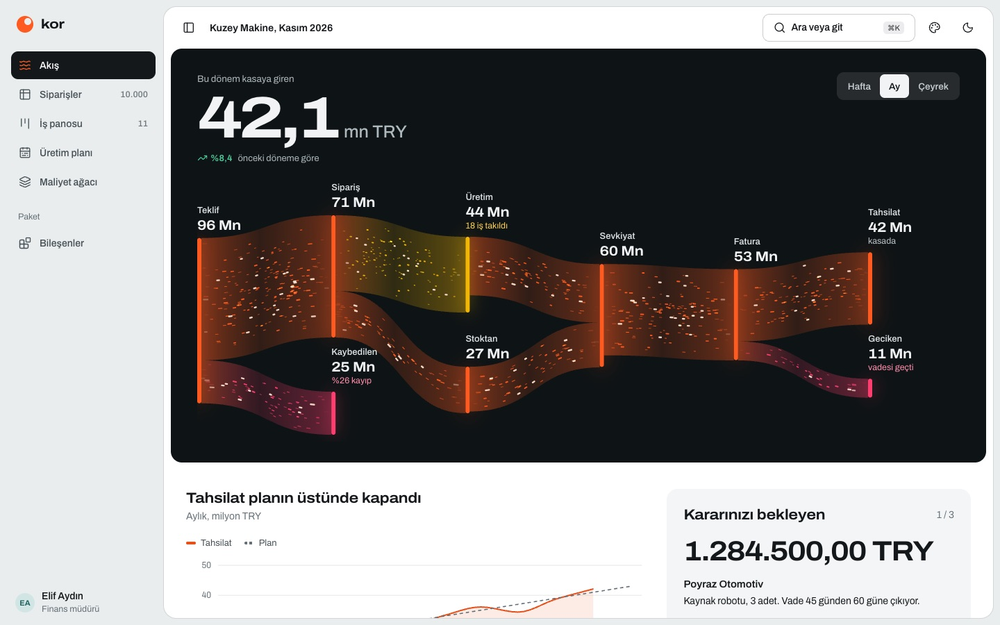
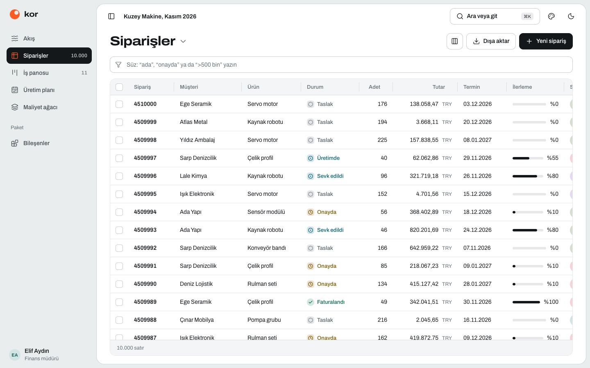

# Kor

[Türkçe](README.tr.md) · [Documentation](https://korui5.abapnews.com/) · [Live demo](https://korui5.abapnews.com/demo/) · [Examples](https://lutfullahkabalak.github.io/kor-ui5-examples/)



Enterprise components for OpenUI5 and SAPUI5 1.108+. Kor does not look like Fiori: it has its own typeface, icons, colors and motion. Yet every part is a native UI5 control, written in XML views, bound to your models and usable with the keyboard. It only needs `sap.ui.core`.

| Area | Controls |
| --- | --- |
| App | `Shell`, `CommandPalette` (⌘K), `Sheet`, `Dialog`, `Confirm`, `Popover`, `Tooltip`, `Tabs`, `Accordion`, `Breadcrumbs`, `Wizard`, `Splitter`, `ColumnLayout`, `RecordPage`, `Inbox`, `Toast`, `Theme` |
| Data | `DataGrid`, `TreeGrid`, `FilterBar`, `Variants`, `Flow`, `Trend`, `BarChart`, `PieChart`, `Stat`, `List`, `Details`, `Compare`, `Pivot`, `Heatmap`, `Waterfall` |
| Planning | `Board`, `Schedule`, `Stages`, `Activity`, `MonthCalendar` |
| Input | `TextField`, `NumberField`, `SelectField`, `MultiSelect`, `LookupField` (F4), `DateField`, `DateRangeField`, `TimeField`, `DateTimeField`, `TreeField`, `Slider`, `Rating`, `PromptField`, `RadioGroup`, `Toggle`, `Check`, `Segmented`, `FileDrop`, `Form` |
| Base | `Button`, `HoldButton`, `Status`, `Person`, `Icon`, `Message`, `MessageList`, `Skeleton`, `Empty`, `Text`, `Stack`, `Link`, `Card`, `Progress`, `Flag` |
| Cargo | `Shipment`, `DeliveryRoute`, `LoadPlan`, `DockBoard` |
| Manufacturing | `ProductionLine`, `MachineCard` |
| Banking | `BankCard`, `BankLogo`, `Statement`, `Installments` |
| Education | `Timetable`, `Classroom`, `CoursePath` |
| Human resources | `OrgChart`, `LeaveBalance`, `ShiftRoster`, `TalentGrid` |



- **DataGrid**: virtual rows (10,000 in the demo), range selection with live totals, inline editing, copy and paste with Excel, column settings. `rows` takes any UI5 list binding; no template needed.
- **Flow**: shows a process as a river. The stream slows down at a bottleneck; press a stop to filter your list.
- **LookupField**: suggests while typing, opens a filterable table on F4.
- **Variants**: saves filters and table layout by name, in the browser or on your server.
- **FilterBar**: type `>500k` or a status; get a ready `sap.ui.model.Filter` array.
- **Theme**: brand color, dark mode, density and corner radius at runtime.

## Use it

```bash
npm install kor-ui5
```

`ui5.yaml` needs `specVersion` 3.0 or higher. Then in `manifest.json`:

```json
"sap.ui5": { "dependencies": { "libs": { "kor.ui": {} } } }
```

```xml
<mvc:View xmlns:mvc="sap.ui.core.mvc" xmlns:k="kor.ui">
	<k:DataGrid rows="{/Orders}" selectionMode="Multi" rowPress=".onOpen">
		<k:columns>
			<k:Column label="Order" path="Id" type="link" pinned="true"/>
			<k:Column label="Customer" path="Customer" grow="1" editable="true"/>
			<k:Column label="Amount" path="Amount" type="currency" unitPath="Currency" decimals="2"/>
		</k:columns>
	</k:DataGrid>
</mvc:View>
```

```js
sap.ui.require(["kor/ui/Theme"], (Theme) => Theme.set({ accent: "#0B7A5B", mode: "system", density: "compact" }));
```

No build chain? Put the `kor/ui` folder from `kor-ui.zip` (releases page) on your server and point the resource root `kor.ui` to it.

## OData

- **V4**: `rows="{path: '/Orders', parameters: {$count: true}}"`. Edits are sent as PATCH; a rejected edit is rolled back.
- **V2**: use a `TwoWay` model and `submitChanges`; `defaultCountMode: "Inline"` is recommended.
- `Edm.Decimal` stays a string, `Edm.DateTime` days are read and written as UTC.
- Text search sends `contains`/`substringof`; case sensitivity is up to the server.

## Status

0.2.0, an early release: names may still change. Known limits:

- Tested on 1.108.55 and 1.154.0 in Chrome. Other versions, Safari and Firefox are untested.
- OData was tested against mock servers, not a real SAP Gateway or RAP service.
- TreeGrid works with JSON and OData V2 client mode; OData V4 hierarchies are not supported.
- Board and Schedule drag and drop need a mouse; there is a keyboard alternative, but no touch yet.
- Not tested with a real screen reader, nor deployed to ABAP or Launchpad.
- Needs a browser with `color-mix()` and `:has()` (2023+).

## License

Apache-2.0, Copyright 2026 Lütfullah Kabalak. Includes the Archivo typeface (SIL OFL 1.1) and Lucide icons (ISC); see [NOTICE](NOTICE). SAP, SAP Fiori and SAPUI5 are trademarks of SAP SE; this project is not affiliated with SAP.
