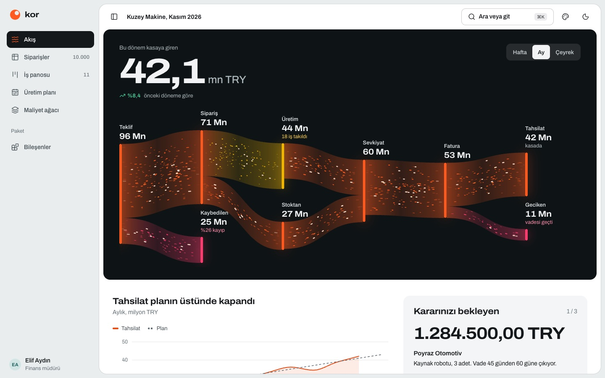

# Kor

[English](README.md) · [Dokümantasyon](https://korui5.abapnews.com/tr/) · [Canlı demo](https://korui5.abapnews.com/demo/?lang=tr) · [Örnekler](https://lutfullahkabalak.github.io/kor-ui5-examples/tr/)



OpenUI5 ve SAPUI5 (1.108+) için kurumsal bileşen paketi. Fiori görünümüne bağlı değildir: kendi yazı tipi, simgeleri, renk sistemi ve hareketleri vardır. Buna karşın her parça gerçek bir UI5 kontrolüdür; XML görünümde yazılır, modele bağlanır, klavyeyle çalışır.

## Neler var

| Alan | Bileşenler |
| --- | --- |
| Uygulama | `Shell`, `CommandPalette` (⌘K), `Sheet`, `Dialog`, `Confirm`, `Popover`, `Tooltip`, `Tabs`, `Accordion`, `Breadcrumbs`, `Wizard`, `Splitter`, `ColumnLayout`, `RecordPage`, `Inbox`, `Toast`, `Theme` |
| Veri | `DataGrid`, `TreeGrid`, `Variants`, `FilterBar`, `Flow`, `Trend`, `Stat`, `List`, `Details`, `Compare`, `Pivot`, `Heatmap`, `Waterfall` |
| Planlama | `Board`, `Schedule`, `Stages`, `Activity`, `MonthCalendar` |
| Giriş | `TextField`, `NumberField`, `SelectField`, `LookupField` (F4), `DateField`, `DateRangeField`, `TimeField`, `DateTimeField`, `TreeField`, `Slider`, `Rating`, `PromptField`, `Toggle`, `Check`, `RadioGroup`, `Segmented`, `MultiSelect`, `FileDrop`, `Form` |
| Eylem | `Button` (menülü), `HoldButton` |
| Temel | `Status`, `Person`, `Icon`, `Message`, `MessageList`, `Skeleton`, `Empty`, `Text`, `Stack`, `Link`, `Card`, `Progress` |
| Kargo | `Shipment`, `DeliveryRoute`, `LoadPlan`, `DockBoard` |
| Üretim | `ProductionLine`, `MachineCard` |
| Bankacılık | `BankCard`, `Statement`, `Installments` |
| Eğitim | `Timetable`, `Classroom`, `CoursePath` |
| İnsan kaynakları | `OrgChart`, `LeaveBalance`, `ShiftRoster`, `TalentGrid` |

- **DataGrid**: sanal satır çizimi (demoda 10.000 satır), aralık seçimi ve anlık toplam, yerinde düzenleme, Excel ile kopyala-yapıştır, sabit sütun. `rows` bir UI5 liste bağlamasıdır; şablon istemez.
- **TreeGrid**: DataGrid'in ağaç hali; UI5 ağaç bağlaması alır (`parameters: {arrayNames: ['children']}`).
- **LookupField**: yazınca önerir, F4 ile süzülebilir tabloda aratır; tek ya da çoklu.
- **Variants**: tablo ve süzgecin durumunu adla saklar (tarayıcıda ya da sizin sunucunuzda), varsayılanla açar.
- **Flow**: süreci nehir gibi gösterir; darboğazdaki akış yavaşlar, durağa basınca liste süzülür.
- **FilterBar**: `>500 bin` ya da `onayda` yazın; hazır `sap.ui.model.Filter` dizisi verir.
- **Schedule / Board**: sürükle-bırak, klavye karşılığı, anında çakışma ve sınır uyarısı.
- **Theme**: tek satırda kurum rengi, koyu görünüm, yoğunluk, köşe.

## Dene

```bash
npm install
npm start
```

## Projede kullan

1. UI5 projenizde:

```bash
npm install kor-ui5
```

2. `ui5.yaml` dosyanız `specVersion` 3.0 veya üstü olsun; kütüphane bağımlılıklardan bulunur.
3. `manifest.json` içine ekleyin:

```json
"sap.ui5": { "dependencies": { "libs": { "kor.ui": {} } } }
```

4. Görünümde kullanın:

```xml
<mvc:View xmlns:mvc="sap.ui.core.mvc" xmlns:k="kor.ui">
	<k:DataGrid rows="{/Orders}" selectionMode="Multi" rowPress=".onOpen">
		<k:columns>
			<k:Column label="Sipariş" path="Id" type="link" pinned="true"/>
			<k:Column label="Müşteri" path="Customer" grow="1" editable="true"/>
			<k:Column label="Tutar" path="Amount" type="currency" unitPath="Currency" decimals="2"/>
		</k:columns>
	</k:DataGrid>
</mvc:View>
```

Kurum renginiz:

```js
sap.ui.require(["kor/ui/Theme"], (Theme) => Theme.set({ accent: "#0B7A5B", mode: "system", density: "compact" }));
```

Derleme zinciri kullanmıyorsanız sürüm sayfasındaki `kor-ui.zip` içindeki `kor/ui` klasörünü sunucunuza koyun ve `data-sap-ui-resourceroots` ile `kor.ui` adını o klasöre yönlendirin.

## OData ile

- **V4**: `rows="{path: '/Orders', parameters: {$count: true}}"`. `$count` yoksa da çalışır, toplam sonda belli olur. Değişiklik PATCH olarak gider; sunucu reddederse hücre geri döner.
- **V2**: model `TwoWay` olmalı; değişiklikler `submitChanges` bekler. `defaultCountMode: "Inline"` önerilir.
- Ondalıklar (Edm.Decimal) metin, V2 tarihleri (Edm.DateTime) UTC gün olarak okunur ve yazılır.
- Metin araması `contains`/`substringof` gönderir; büyük-küçük harf duyarlılığını sunucu belirler.
- "Tümünü seç" yüklenmeyen satırları da sunucudan ister. V4'te süzme ve sıralamadan sonra görünmeyen eski seçim düşebilir.

## Durum

0.1.0, erken sürüm. Bilinen sınırlar:

- Testler 1.108.55 ve 1.154.0 ile Chrome'da koşar; aradaki sürümler, Safari ve Firefox denenmedi.
- OData V2 ve V4, sahte sunucuyla denendi (sayfalama, sıralama, süzme, seçim, F4, V4 PATCH). Gerçek bir SAP Gateway/RAP servisinde denenmedi.
- TreeGrid OData V2'de istemci kipiyle (`operationMode: 'Client'`) denendi; OData V4 hiyerarşisi desteklenmez.
- Pano ve plan sürüklemesi fare içindir; dokunmatikte henüz yok.
- Ekran okuyucu ile elle deneme yapılmadı.
- Tarayıcıda `color-mix()` ve `:has()` gerekir (2023 sonrası sürümler).

## Geliştirme

`npm test` (yerel Chrome ister), `npm run typecheck`, `npm run build` (`npm/` paketi, `site/` demosu, `release/` hazır dosyalar). `*.gen.d.ts` ve `src/icons.ts` üretilir, elle düzenlemeyin.

## Lisans

Apache-2.0, Copyright 2026 Lütfullah Kabalak. Ticari projelerde kullanabilirsiniz.

## Üçüncü taraf

Archivo yazı tipi (SIL OFL 1.1) ve Lucide simgeleri (ISC). Lisans metinleri `src/assets/` içindedir. SAP, Fiori ve SAPUI5, SAP SE'nin markalarıdır; bu proje SAP ile bağlantılı değildir.
